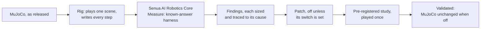

# Senua AI Robotics Core: MuJoCo deep dive

**Senua AI's Measure held Google DeepMind's MuJoCo to the laws of physics and to the problems its users report: 21
issues, 20 counted once each. Sixteen are fixed and validated, the configuration and Senua AI's patches proven
together as one set; in three no departure was found, and one is outside this deep dive.**

| MuJoCo as released | With Senua AI |
|---|---|
| **A held object slides away.** A cube pushed with 60% of what friction can hold creeps 1.3 mm a second; an arm resting on its tip creeps up to 0.7 mm a second | **It holds: 0 mm a second**, a cube held from turning up to 95% of the limit, a gripped cube too, and an arm resting on its tip, set down or dropped, in every pose played. Two options MuJoCo already has, chosen and proven by Senua AI ([Studies 2, 10 and 11](docs/studies/README.md)), with Senua AI's patch for the arm, 67 lines ([Study 15](docs/studies/15-the-set-together.md)), and its second version for torsional and rolling friction ([Study 21](docs/studies/21-four-groups.md)). A free cube pushed square to a face at 95% of its limit, which still crept 1.5 mm a second, holds with two more of MuJoCo's own options ([Study 23](docs/studies/23-impratio-and-the-stiffest-contact.md)) |
| **Friction depends on direction.** A cube slid at 45 degrees goes 42% further than along an axis | **The same slide in every direction played**, to the micrometre. Senua AI's patch, 25 lines ([Study 1](docs/studies/01-friction-without-a-direction.md)) |
| **The same arm ends in a different place depending on how its scene file is written.** Started in the same place, it ends up to 25.6 mm apart | **0 nm apart, in every writing.** Senua AI's patch, 104 lines ([Studies 5, 7, 8, 9 and 10](docs/studies/README.md)) |
| **A joint held by friction creeps.** Held level by friction half again its load, a joint turns 1.5 degrees a second; under the elliptic cone with 10 noslip iterations a two-link arm held by joint friction still creeps up to 0.4 mm a second | **It holds: 0 for the joint, 3 um a second for the arm.** 100 noslip iterations in place of 10, MuJoCo's own option, every contact play unchanged ([Study 13](docs/studies/13-noslip-joint-friction.md)) |
| **A sliding body hops off the ground.** Under the elliptic cone a cube slid at 0.81 m/s rises 4.4 mm at a 10 ms step; free to turn, it slides up to 1.9% further along some directions, drifts and turns | **It stays on the ground, and slides the same along every direction**, to the micrometre. Senua AI's patch, de Saxce's correction, 103 lines ([Study 12](docs/studies/12-desaxce-elliptic.md)) |
| **A straight stack of equal cubes tips over.** Under the elliptic cone with noslip, stacks of 9 and 12 cubes tilt up to 10.9 mrad at some steps and stand at others | **Every straight stack stands**, 3 to 12 cubes, at every step and tolerance played, its contacts never changing. Senua AI's patch to MuJoCo's box-on-box collision, 35 lines ([Study 16](docs/studies/16-boxbox-collinear.md)) |
| **A box that should rest keeps rocking.** MuJoCo's own test scene with rolling friction and noslip never comes to rest: from its first steps the box rocks onto an edge every six steps, up to 77 mm/s | **It comes to rest**, and three fresh boxes too, at every step and noslip setting played. Senua AI's patch to noslip's rolling friction, 45 lines ([Study 19](docs/studies/19-noslip-rolling-kept.md)) |
| **A joint held by friction drags what it is coupled to.** With noslip, a joint its friction holds stays still while a joint coupled to it by an equality moves and stays moved: up to 1.64 m in 1 s in scenes built after the case MuJoCo's users reported (issue #2430) | **The coupling holds, under 1 um apart**, the held joint held, and everything without an equality plays exactly as before. Senua AI's patch to noslip, 35 lines ([Study 22](docs/studies/22-noslip-equality-and-convex-parts.md)) |
| **A concave mesh collides as a shape it is not.** A ball dropped into a cup written as one mesh rests on a lid that is not there, 36 to 40 mm above the cup's floor | **It rests on the floor**, the cup written as convex parts, meshes or primitives alike to the nanometre: MuJoCo's documented remedy, chosen and proven by Senua AI ([Study 22](docs/studies/22-noslip-equality-and-convex-parts.md)) |
| **A stack sinks, and an offset stack leans.** Cubes stacked sink up to 0.9 mm at one contact under the elliptic cone; three cubes set each over the one below lean up to 5.4 mrad, and under noslip keep turning | **Every contact within 11 um, every lean within 0.05 mrad, every offset stack at rest.** Impratio and a contact as stiff as MuJoCo allows, two more of its own options, chosen and proven by Senua AI ([Study 23](docs/studies/23-impratio-and-the-stiffest-contact.md)) |
| **Friction that holds, or inverse dynamics, not both.** With noslip holding friction exactly, inverse dynamics differs from the forward step by the whole force friction holds, up to 34,723 N | **Each in its own form.** Without noslip, every friction as stiff as MuJoCo allows: inverse dynamics agrees to under 1 nN, every hold and grip holds, and friction creeps by a law Senua AI measured, under 2 um a second at gravity's load ([Study 23](docs/studies/23-impratio-and-the-stiffest-contact.md)) |
| **The same play gives other bytes on arm64.** Google DeepMind's arm64 release departs from Intel in 50 of 114 plays, at the last digit, which a moving stack amplifies | **The same bytes on both**, MuJoCo built with gcc, or with clang and fused multiply-add off, and Senua AI's set too ([Study 24](docs/studies/24-arm64-against-intel.md)) |

**Better than the fixes already out there.** Held to the same answers as every fix in use or proposed for a held
object that creeps, MuJoCo's own options and pull request #3349's stiction among them, only Senua AI's held every one:
the others creep, or pull a moved body back and fail to restore a saved state
([Study 11](docs/studies/11-fixes-in-the-wild.md); every fix with its pros and cons:
[the fixes in the wild, measured](docs/fixes-in-the-wild.md)).

**Proven, not claimed:** 24 pre-registered studies, every rule written before its data existed; MuJoCo unchanged with
the patches off, file for file and all 3,492 of its own tests as released; every run from 001 to 106 replays byte for
byte, and every number on the pages to run 100 is traced to its files ([the audit](docs/audit.md)); runs 107 and 108
and the pages since are next. **No models, no GPU:** CPUs only, Intel and arm64.

**Held to textbook physics, with its sources:** Coulomb's law of friction ([Coulomb 1785](docs/references.md#coulomb)),
the conservation of momentum, energy and angular momentum and Euler's equations of a rotating body ([Landau and
Lifshitz](docs/references.md#landau)), the coefficient of restitution ([Stronge](docs/references.md#stronge)), the
integrators' known error ([Hairer, Lubich and Wanner](docs/references.md#hairer-gni)), and MuJoCo's own published model
([Todorov, Erez and Tassa 2012](docs/references.md#todorov-2012), [Todorov 2014](docs/references.md#todorov-2014)) with
the contact literature it rests on ([the references](docs/references.md)).

**All 21 issues, 20 counted once each:** 16 fixed and validated, 3 with no departure found where measured, 1 outside
this deep dive ([the issues](docs/issues.md)). **The one trade-off, measured and stated:** friction held exactly
under any load and inverse dynamics cannot both be had, MuJoCo's documented limit of hard friction, so Senua AI's
configuration comes in two forms, one for each; without noslip, friction creeps by a law, (1 - I) dt a, which Study 23
held to 0.05 per cent.

**Together:** the configuration with Senua AI's three patches held all 33 of its rules as one set, the arm, holds and
grips under both MuJoCo's default integrator and RK4 ([Study 15](docs/studies/15-the-set-together.md)). Each patch and
option since was validated inside the set as it then stood (Studies 16, 19, 21, 22, 23 and 24): the configuration in its
two forms and Senua AI's six patch files are one validated set ([the patches](docs/patches.md)).

The second deep dive, after Meta's SuperDex Physics; Newton (Linux Foundation; NVIDIA, Google DeepMind, Disney
Research) is next, held to the same Measure. The same measurement, validation and patching apply to any physics
engine or robotics framework.

## What Senua AI found and fixed in MuJoCo, in detail

| MuJoCo 3.16.0 as released | What the Senua AI Robotics Core measured | With Senua AI |
|---|---|---|
| **Friction has a direction** under the default friction cone | A cube slid at 30 degrees to the cone's axes goes 30% further than along an axis and leaves its line by 23 mm; at 45 degrees (run 003), 42% further. Pushed along 30 degrees with 85% of the friction it is rated for, a held cube slides away at 0.3 m/s | **Corrected.** Senua AI's patch gives the same slide along every direction played to the micrometre, no drift, and the same hold as along an axis. **Validated: 17 of 17 pre-registered rules** ([Study 1](docs/studies/01-friction-without-a-direction.md)). MuJoCo's own test suite passes test for test with it off; with it on, four side effects to answer before merging ([run 020](validation/run_020_mujoco_test_suite/README.md)); a third version answers them but the lift and passes every check and MuJoCo's whole suite ([run 022](validation/run_022_pyramid_v3/README.md)); its three registered studies held 29, 29 and 31 of 32 rules, failing only by the runner and by a step or a percent that MuJoCo's own direction-free cone does not keep against its own pyramid ([Study 3](docs/studies/03-pyramid-third-version.md), [Study 4](docs/studies/04-pyramid-third-version-fresh.md), [Study 6](docs/studies/06-pyramid-third-version-same-run.md)) |
| **Nothing holds at rest** | A cube pushed with 60% of what friction can hold creeps at 1.3 mm a second, at every step; a cube gripped between two pads with friction for twice its weight slips out at 6.1 mm a second ([run 027](validation/run_027_grip_and_meshes/README.md)) | **Corrected by configuration.** Senua AI's recommended configuration, two options MuJoCo already has (the elliptic cone with noslip), holds every load Studies 2 and 10 gave it, up to 0.95 of the limit, to 0 and removes the direction too; an arm resting on its ball crept in one pose of two (714 um/s) until Senua AI's patch, the friction solved in the directions that can move, held every pose, set down and dropped (**validated in the set, 33 of 33 rules**, [Study 15](docs/studies/15-the-set-together.md)), for MuJoCo's default contact. A cube that cannot turn, with condim 4 or 6, crept, 498 um/s at half its limit ([run 084](validation/run_084_set_condim_holds/README.md)), until the friction solve's second version held all 108 holds ([Study 21](docs/studies/21-four-groups.md)); a free cube pushed square to a face at 0.95 of its limit crept under noslip, 173 to 1,124 um/s ([Study 20](docs/studies/20-qcqp-reduced-v2.md)), until impratio 1,000 and every contact's time constant at twice the step held it at 0 ([Study 23](docs/studies/23-impratio-and-the-stiffest-contact.md)). **Validated: 11 of 11 pre-registered rules** ([Study 2](docs/studies/02-recommended-configuration.md)), and **replicated on fresh numbers** with the grip held too, end to end with the patch below ([Study 10](docs/studies/10-recommended-configuration-end-to-end.md)), and **the only fix in the wild that held every rule**, beside MuJoCo's own options and pull request #3349's stiction ([Study 11](docs/studies/11-fixes-in-the-wild.md)) |
| A sliding body leaves the ground | A cube set sliding at 1.2 m/s rises 10.8 mm off the ground at a 10 ms step, 0.8 mm at 2.5 ms | Friction makes it: the elliptic cone's convex relaxation of Coulomb friction; none of the cone, noslip, impratio, or the solref and solimp values MuJoCo documents removes it without a cost of its own ([runs 016](validation/run_016_sliding_lift/README.md), [019](validation/run_019_lift_solref_solimp/README.md)). **Corrected under the elliptic cone.** Senua AI's patch, de Saxce's correction, keeps the cube on the ground at every step. **Validated: 43 of 43 pre-registered rules** ([Study 12](docs/studies/12-desaxce-elliptic.md)), with every hold and grip as released; two of MuJoCo's tests fail with it on, both traced in advance; under noslip it tipped a stack of 9 the release keeps upright. Under the default pyramidal cone the lift remains ([run 050](validation/run_050_stacks_box_and_limits/README.md)) |
| The default integrator adds energy | A free two-link chain gains 9.7% of its energy and 6.6% of its momentum in 2 s at 10 ms; a single body tumbling with nothing acting on it, up to 3.4% and 1.3% ([run 039](validation/run_039_weld_and_tumble/README.md)) | **Corrected by configuration.** MuJoCo's own RK4 keeps a tumbling body's energy and angular momentum at every step, 8 of 8 rules, where Euler, implicitfast and implicit each fail 4 of 8 ([Study 9](docs/studies/09-weld-and-tumbling-body.md)); and, on fresh numbers, a free chain's to 1 ppm and a tumbling body's exactly at four steps, **validated: 7 of 7 rules** ([Study 18](docs/studies/18-rk4-free-body.md)) |
| A free cube has a direction under the elliptic cone | Slid free to turn along 22.5 degrees under the recommended configuration, a cube goes 1.4% to 2.3% further than along 0 or 45 degrees; under the defaults, 20% further and 35 mm off its line | Traced to the lift: the hopping cube lands on its corners, whose friction turns it off its line ([run 045](validation/run_045_f12_free_cube_direction/README.md)). **Corrected** by the same patch: the same slide along every direction to the micrometre, no drift, no turn, all four corners on the ground. **Validated** ([Study 12](docs/studies/12-desaxce-elliptic.md)) |
| **A constraint's softness depends on how the scene is written** | The same arm, in the same place and at rest, its tip on the ground, sinks 169 or 105 um and creeps at 0.85 or 0.52 mm/s depending only on the pose its file was written in; held up by joint friction, it ends up to 32 mm apart by writing ([run 034](validation/run_034_joint_friction_written_pose/README.md)) | Measured: MuJoCo takes each contact's softness from inverse weights frozen in the written pose; a tighter solve does not change it, and the elliptic cone with noslip stops the creep in one pose of two, not the depth ([run 025](validation/run_025_diagonal_approximation/README.md)). MuJoCo's own `diagexact` flag removes it, but makes straight stacks and a centred grip turn under the default cone ([run 028](validation/run_028_diagexact/README.md)). **Corrected.** Senua AI's patch, MuJoCo's own formula taken where the bodies are, ends every writing in the same place to the nanometre and changes no cube scene and none of MuJoCo's tests. **Validated: 86 of 86 pre-registered rules** ([Study 5](docs/studies/05-inverse-weight-current-pose.md)); its second version, for joint limits and joint friction too, which runs 032 and 034 found affected (released, Study 7's arm ends up to 21 mm apart by writing), **validated: 134 of 134 rules** ([Study 7](docs/studies/07-inverse-weight-joints.md)); and its third version, equality constraints too (run 036), **validated: 154 of 154 rules** ([Study 8](docs/studies/08-inverse-weight-equalities.md)), and for a `weld`, **26 of 26 rules** ([Study 9](docs/studies/09-weld-and-tumbling-body.md)); and under the recommended configuration, with the default integrator and with RK4, **validated** ([Study 10](docs/studies/10-recommended-configuration-end-to-end.md)) |
| A stack sinks, and an offset stack leans | Ten cubes stacked lose 1.6 mm at their contacts, 6.1 mm under the elliptic cone with noslip; three cubes set each 20 mm over the one below tilt by up to 1.5 mrad and creep | Measured: every cube carries its weight and a box slides on a box face as on the ground; the soft contact sinks with the load, twice as deep between two bodies as on the ground ([run 026](validation/run_026_stack_and_faces/README.md)), as deep as the model's own softness says ([run 089](validation/run_089_order_free_cube_stacks/README.md)), by a depth that falls with the square of its time constant ([run 102](validation/run_102_contact_time_constant/README.md)); under noslip a stack offset 1 or 5 mm a cube keeps turning, at up to 31 mrad/s, the instability MuJoCo's documentation names ([run 093](validation/run_093_stacks_converged/README.md)). **Corrected by configuration.** Every contact's time constant at twice the step, the stiffest MuJoCo's own guard allows, with impratio 1,000: every contact of stacks of 3, 5 and 10 within 10.8 um where it sank up to 901, every lean within 47 urad, every offset stack at rest, with noslip or without it. **Validated: 8 of 8 rule lines** ([Study 23](docs/studies/23-impratio-and-the-stiffest-contact.md)) |
| A bounce depends on the step | Set the documented way, one bounce setting rebounds 0.03 to 0.63 of the drop across the steps; at 10 and 5 ms a bouncier one throws the cube 1.2 to 104 times higher than it fell, or more | **Corrected by configuration**: a step at most half the contact's time constant times its damping ratio, the spring MuJoCo's own discrete integrator calls resolved. Then one setting gives one bounce, the same at every step to within 0.05 of the drop, never above it ([Study 21](docs/studies/21-four-groups.md)). A step that cannot resolve the spring throws the cube up to 47 times as high as it fell |
| **Noslip breaks a joint equality** | With noslip, a joint its friction holds stays still and a joint coupled to it moves and stays moved, as MuJoCo's issue #2430 reports: 386 um to 1.64 m in 1 s ([run 094](validation/run_094_noslip_costs/README.md), Study 22). Noslip re-solves the friction rows only | **Corrected.** Senua AI's patch: noslip's pass re-solves the equality rows too, as MuJoCo's own PGS solves them; the coupling under 1 um apart, the held joint held, nothing without an equality changed ([Study 22](docs/studies/22-noslip-equality-and-convex-parts.md)) |
| **Inverse dynamics cannot agree with noslip** | With noslip, MuJoCo's own forward-inverse comparison differs by the whole force friction holds: 3.35 N at a push of 3.35 N ([run 094](validation/run_094_noslip_costs/README.md)), up to 34,723 N (Study 23). Friction held exactly makes inverse dynamics ill-defined, as MuJoCo's computation chapter says | **A configuration for it.** Without noslip, impratio 1,000 and every contact's and joint's friction as stiff as MuJoCo allows: inverse dynamics agrees to under 1 nN, every hold, grip, arm and stack of the set holds, and friction creeps by a law Senua AI measured, (1 - I) dt a, within 0.05 per cent. **Validated: 49 of 49 rule lines**, with the other form, noslip kept, for friction exact under any load ([Study 23](docs/studies/23-impratio-and-the-stiffest-contact.md)) |
| **Deterministic only on one architecture** | Google DeepMind's arm64 release, played on a Graviton3 machine, departs from the Intel release in 50 of 114 plays, the contact-rich ones, first within 38 to 1,449 steps ([run 107](validation/run_107_arm64/README.md), Study 24) | Traced: the release is built with clang, which fuses a multiply and an add into one rounding on arm64; a clang build reproduces it byte for byte. **Corrected by configuration.** MuJoCo built from its source with gcc, or with clang and `-ffp-contract=off`, makes the same bytes on arm64 as on Intel, and so does Senua AI's set. **Validated: 12 of 12 rule lines** ([Study 24](docs/studies/24-arm64-against-intel.md)) |
| **A mesh collides as its convex hull** | A ball dropped into a cup written as one mesh rests on the hull's top, a lid that is not there, 36 to 40 mm above the floor ([run 092](validation/run_092_mesh_hull_cup/README.md), Study 22) | **Corrected by configuration.** The cup written as convex parts, MuJoCo's documented remedy: the ball rests on the floor, meshes and primitives alike to the nanometre ([Study 22](docs/studies/22-noslip-equality-and-convex-parts.md)) |

**On the same ten known-answer tests SuperDex was held to:** MuJoCo as released passes 9 of 10, and **10 of 10 with
Senua AI's recommended configuration** (Study 2). SuperDex as released passes 6. MuJoCo is deterministic to the byte, on macOS and Linux
alike, and gets friction at an impact, free joint motion and the smallest rotations right as released.

**End to end, on fresh numbers** ([Study 10](docs/studies/10-recommended-configuration-end-to-end.md), 290 of 298 rule
lines): the recommended configuration with Senua AI's patch keeps every hold, every grip, a slide kept from turning and
every written pose right under MuJoCo's default integrator, and a free spinning body right under RK4; no single
integrator passes every rule, and a free cube still has a direction, so it was not recorded as validated end to end.
Since then de Saxce's correction removed the direction (Study 12), and the configuration with Senua AI's three patches
held all 33 rules of [Study 15](docs/studies/15-the-set-together.md) together.

## How Senua AI did it

1. **Measurement.** A rig, a thin C adapter on MuJoCo's own API, plays the smallest scenes physics has an answer for
   (one cube, two cubes, one arm, a chain) at a ladder of step sizes and writes what happened. The Senua AI Robotics Core's
   measuring programs read those files and hold MuJoCo to the answer, with tolerances fixed in advance: the same programs that
   measured SuperDex.
2. **Validation.** Every study's rules are written and published before its data exists, and the study is played once.
   A correction is held to five checks: required, correct, nothing else gets worse, the engine byte-identical to
   the release when the correction is off, and the solver still converging.
3. **Patching.** A finding becomes a change a maintainer can merge, lines added to MuJoCo's C (25 for the friction pyramid, 104 for the inverse weight in the current pose), off unless its switch is
   set, with the full evidence beside it.

[How the Robotics Core works on MuJoCo](docs/how-it-works.md), in detail.

## Our difference

- **We do not use models. No LLMs and no SLMs, of any kind.** The Senua AI engine learns the structure of a signal
  directly from the signal itself.
- **No GPU and no data centre.** Every play and every measurement here ran on CPUs: an Intel laptop and cloud machines
  with 2 to 16 virtual CPUs.
- **No AI token costs, ever.**
- **Fully auditable.** Every study's rules are published before its data exists, every run is kept, and the whole record replays and
  re-measures byte for byte ([the audit](docs/audit.md)).

## The documentation

| Page | What it covers |
|---|---|
| [How the Robotics Core works on MuJoCo](docs/how-it-works.md) | The rigs, the measuring, the studies and the patches, and which part is Senua AI's |
| [What was found](docs/findings.md) | Every finding with its numbers, and what MuJoCo gets right |
| [The patches](docs/patches.md) | Senua AI's validated set, the configuration in its two forms and six patch files; each patch, what it changes, how it was held to the five checks, how to use it |
| [The studies](docs/studies/README.md) | Each pre-registered study: the question, the rules, the result |
| [The runs](docs/runs.md) | Every run, probes included, with its one-line result |
| [What users report](docs/known-issues.md) | MuJoCo's reported issues, each linked to its source, with its status in this record |
| [Reproduce it](docs/reproduce.md) | Download, build, play and compare byte for byte |
| [The references](docs/references.md) | The textbook physics the record is held to and the published work it cites, every DOI and arXiv number checked |
| [The audit](docs/audit.md) | Every run from 001 to 100 replayed and re-measured byte for byte, and every number on the pages to run 100 traced to its file; runs 101 to 106 next |

## Licence

MuJoCo is Apache-2.0 by Google DeepMind. The patches in `patches/` modify MuJoCo source and are offered under
Apache-2.0, a copy of which is in [`patches/LICENSE`](patches/LICENSE) and at the root as [`LICENSE`](LICENSE). The rigs
and scripts in `tools/`, the measuring programs in `measure/` and the scripts under `validation/` are Apache-2.0 too.
The documentation, the registrations and the recorded runs are CC-BY-4.0
(<https://creativecommons.org/licenses/by/4.0/>). The Senua AI engine is proprietary to Senua AI and is not included.

MuJoCo 3.16.0 by Google DeepMind, Apache-2.0, at the commit in [`UPSTREAM_COMMIT`](UPSTREAM_COMMIT): the engine DeepMind
acquired in 2021 as its robotics team's simulator of choice and open-sourced in 2022 ([Google DeepMind
2021](docs/references.md#deepmind-2021), [2022](docs/references.md#deepmind-2022)). As of 18 October
2026.
